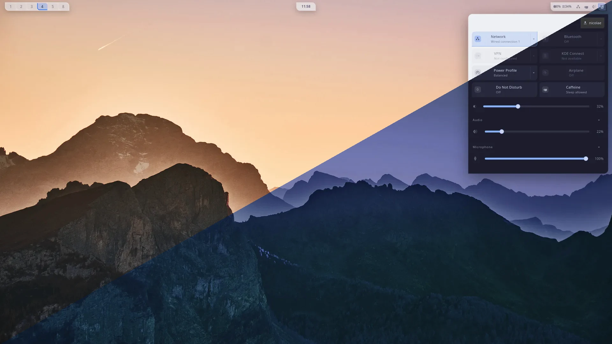
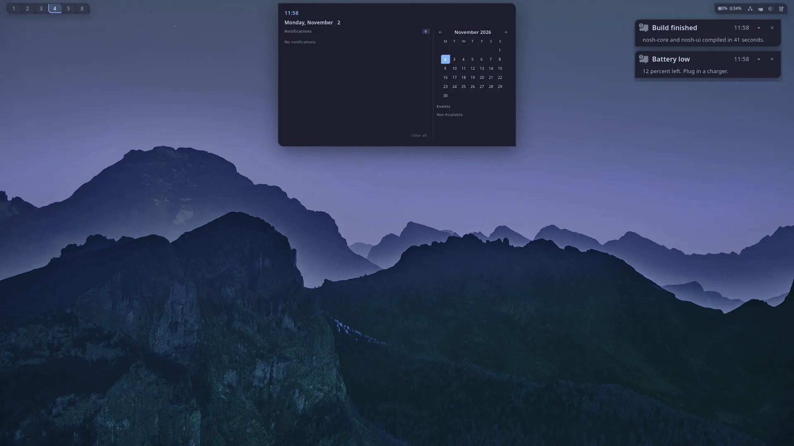
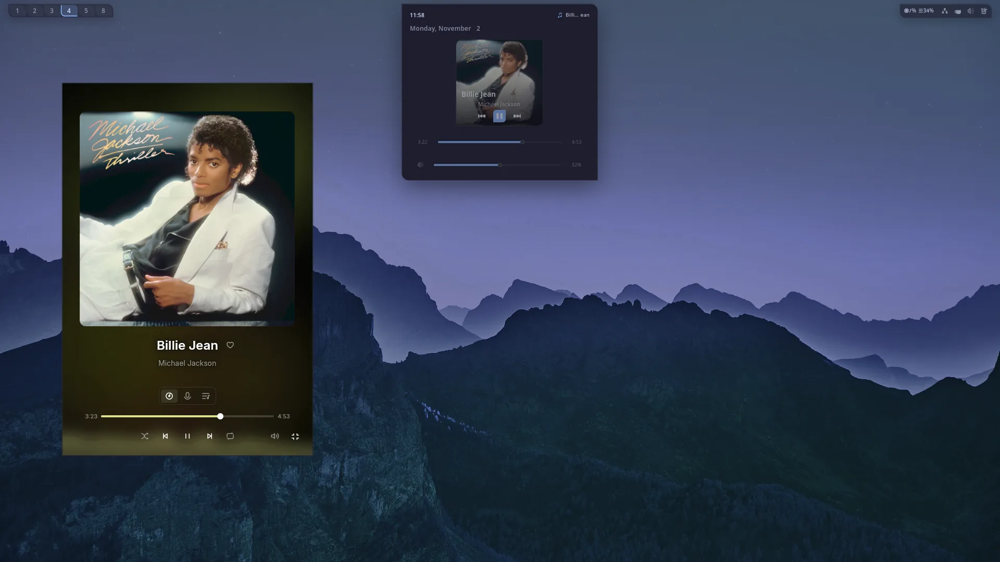
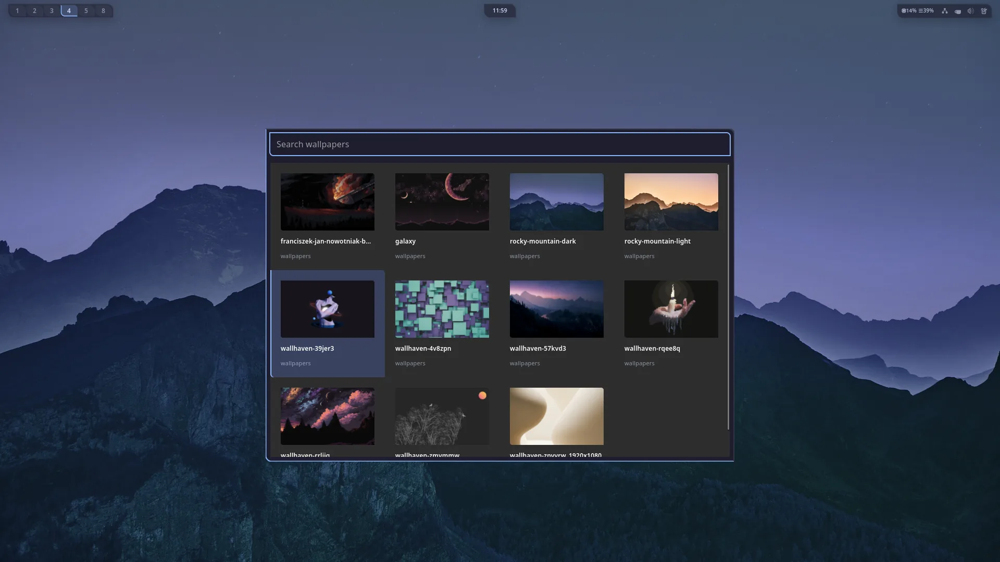
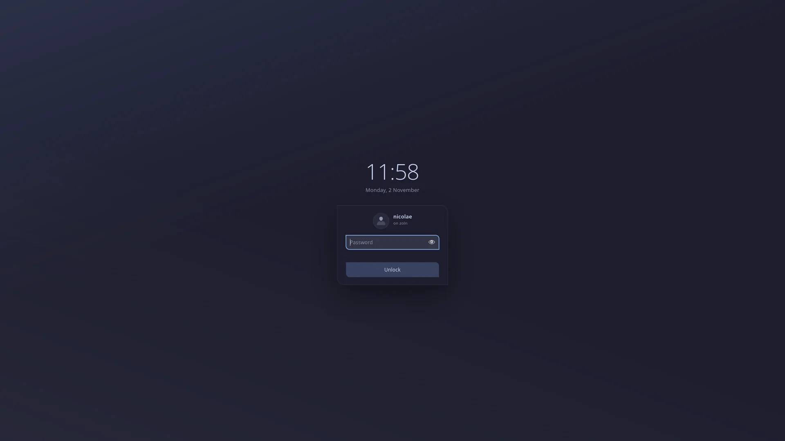
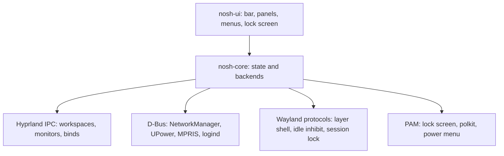

<h1 align="center">nosh</h1>

<p align="center">Everything I want from a Wayland desktop shell, in one process: bar, notifications, menus, lock screen, and polkit prompt.</p>

<p align="center">
  <a href="flake.nix"></a>
  <a href="Cargo.toml"></a>
  <a href="https://gtk.org"></a>
  <a href="https://kernel.org"></a>
  <a href="Cargo.toml"></a>
</p>

<p align="center">
  
</p>

> [!NOTE]
> nosh is at 0.2.0. I use it every day, but parts of it still need work. If something breaks, open an issue with your compositor, monitor layout, and the steps that led to it.

## Why I built it

I wanted one shell for my Hyprland session instead of a bar, a notification daemon, a launcher, a lock screen, and a polkit agent that each keep their own state. nosh is that shell. One GTK4 process draws the surfaces, and one core reads the compositor and the desktop services.

I started it as a rewrite of an old Vala tree. That tree is gone. This is the version I run.

## Contents

- [Screens](#screens)
- [Installation](#installation)
- [First run](#first-run)
- [Configuration](#configuration)
- [Personal scripts](#personal-scripts)
- [Commands](#commands)
- [Architecture](#architecture)
- [Components](#components)
- [Development](#development)
- [Status](#status)
- [License](#license)

## Screens

<table>
  <tr>
    <td align="center"><br><sub>Centre panel</sub></td>
    <td align="center"><br><sub>Media</sub></td>
  </tr>
  <tr>
    <td align="center"><br><sub>Wallpapers</sub></td>
    <td align="center"><br><sub>Lock screen</sub></td>
  </tr>
</table>

## Installation

### Try it

You do not need PAM, udev rules, a systemd unit, or any optional service to start the shell. Build it and run it inside your session:

```bash
git clone https://github.com/NicolaeGr/nosh
cd nosh
cargo build --release -p nosh-ui --no-default-features --features stable
./target/release/nosh
```

The bar maps on every monitor. Widgets whose service is missing stay unavailable, and Ctrl+C closes the shell. The shell itself is not installed and no system files are touched. The only sudo in this section is the package install command for your distribution.

The build needs Rust 1.87 or newer, a C toolchain, pkg-config, GTK4, gtk4-layer-shell, libpulse, and libwayland. These commands install only that.

### Arch

```bash
sudo pacman -S --needed base-devel git rust cargo pkgconf gtk4 gtk4-layer-shell libpulse wayland
```

### Debian and Ubuntu

```bash
sudo apt install build-essential git pkg-config cargo rustc libgtk-4-dev libgtk4-layer-shell-dev libpulse-dev libwayland-dev
```

`libgtk4-layer-shell-dev` is not in every Debian or Ubuntu release. If apt cannot find it, build gtk4-layer-shell from source first.

### Fedora

```bash
sudo dnf install gcc gcc-c++ git make pkgconf-pkg-config cargo rust gtk4-devel gtk4-layer-shell-devel pulseaudio-libs-devel wayland-devel
```

If `cargo --version` is older than 1.87, install Rust with rustup.

### Optional services

Install only what you use. A missing service does not stop the shell; the module that needs it stays unavailable.

| Package                                       | What it enables                                       |
| --------------------------------------------- | ----------------------------------------------------- |
| `brightnessctl`                               | brightness on the internal panel                      |
| `ddcutil`                                     | brightness on external monitors over DDC/CI           |
| `upower`                                      | the battery meter                                     |
| `networkmanager`                              | the network widget, Wi-Fi, and VPN                    |
| `power-profiles-daemon`                       | power profile control                                 |
| `polkit`                                      | the polkit daemon for privileged prompts              |
| `pam`                                         | `nosh lock`, the power menu, and nosh's polkit prompt |
| `pipewire` and `wireplumber`, or `pulseaudio` | audio, microphone, and media volume                   |
| `awww`                                        | only the wallpaper menu example in this README        |

nosh claims `org.freedesktop.Notifications` at startup. Stop another notification daemon if you want its cards.

The polkit prompt is optional. If another agent already handles the session, nosh leaves it alone. If you use your own locker and your own polkit agent, you can skip the PAM step and the nosh prompt together.

### Install it

```bash
cargo build --release -p nosh-ui --no-default-features --features stable
sudo install -Dm755 target/release/nosh /usr/local/bin/nosh
```

Installing the binary to `/usr/local/bin` needs sudo. Everything before that works from the checkout.

### AUR

The PKGBUILD in `packaging/aur` builds the current git tree. It depends on the core libraries only and lists the services as optional packages.

```bash
git clone https://github.com/NicolaeGr/nosh
cd nosh/packaging/aur
makepkg -si
```

The package is named `nosh-git`. Once it is published, `yay -S nosh-git` or `paru -S nosh-git` does the same.

### Nix

Try it without installing:

```bash
nix run github:NicolaeGr/nosh
```

For a full session, the flake ships a NixOS module plus Home Manager and hjem modules. The NixOS module installs the package, starts the user service, enables UPower, creates the `nosh-auth` PAM service, enables I2C, and adds the brightness and DDC udev rules.

On NixOS with Home Manager or hjem, enable one integration:

```nix
services.nosh.withHM = true;    # Home Manager
services.nosh.withHJEM = true;  # hjem
```

Use one or the other. The NixOS module must be imported as `inputs.nosh.nixosModules.default` for these options to exist.

With Home Manager or hjem alone, import the matching module and enable it:

```nix
programs.nosh.enable = true;
```

This installs the package and the user service. You add UPower, the PAM service, the udev rules, and the I2C setting yourself.

For the package alone, install it and start it by hand:

```bash
nix profile install github:NicolaeGr/nosh
nosh
```

There is no service, no PAM stack, and no udev rules in this mode. Start it from your compositor with `exec-once = nosh`, or write your own unit.

### System integration

These steps are optional. The NixOS module performs them for you.

<details>
<summary>PAM stack</summary>

The lock screen, power menu, and nosh's polkit prompt ask PAM directly. If you use your own locker and your own polkit agent, skip this. If `nosh-auth` is missing, nosh falls back to the `login` stack, which can grant more than a shell-specific stack. Without libpam or a usable stack, `nosh lock` and the session actions fail to authenticate.

On Debian and Ubuntu:

```bash
sudo tee /etc/pam.d/nosh-auth >/dev/null <<'EOF'
auth include common-auth
account include common-account
EOF
```

On Arch and Fedora:

```bash
sudo tee /etc/pam.d/nosh-auth >/dev/null <<'EOF'
auth include system-auth
account include system-auth
EOF
```

</details>

<details>
<summary>Backlight and DDC permissions</summary>

```bash
sudo groupadd -f i2c
sudo usermod -aG video,i2c "$USER"
echo i2c-dev | sudo tee /etc/modules-load.d/i2c-dev.conf
sudo modprobe i2c-dev
```

Log out and back in after changing the groups.

</details>

<details>
<summary>User service</summary>

Change `ExecStart` to `/usr/bin/nosh` if you installed the AUR package.

```bash
mkdir -p ~/.config/systemd/user
cat > ~/.config/systemd/user/nosh.service <<'EOF'
[Unit]
Description=nosh
After=graphical-session.target
PartOf=graphical-session.target

[Service]
ExecStart=/usr/local/bin/nosh
Restart=on-failure
RestartSec=5

[Install]
WantedBy=graphical-session.target
EOF
systemctl --user daemon-reload
systemctl --user enable --now nosh
```

If your session manager does not export the Wayland variables to systemd, run this after login:

```bash
systemctl --user import-environment WAYLAND_DISPLAY HYPRLAND_INSTANCE_SIGNATURE
systemctl --user restart nosh
```

You can also skip the unit and start it from your compositor with `exec-once = nosh`.

</details>

## First run

Start the service, or run `nosh` yourself. The bar appears on every enabled monitor.

On first start, nosh writes `$XDG_CONFIG_HOME/nosh/menus.toml` and creates `menus.d/`. The generated file defines the `apps` and `menus` menus, so the running configuration is visible instead of implicit.

```bash
nosh menu apps        # app launcher
nosh menu menus       # selector for the other menus
nosh menu wallpapers  # once you add a wallpaper drop-in
```

If you use Hyprland, a menu can register its own chord from a `[menu.<id>.bind]` section. nosh writes the bind at startup and skips a chord another program already owns unless you set `forced = true`. On another compositor, bind the commands in that compositor's config. A manual Hyprland bind still works:

```text
bind = SUPER, X, exec, nosh menu apps
bind = SUPER, M, exec, nosh menu menus
```

The shell runs outside Hyprland. The bar, quick settings, notifications, menus, power menu, and polkit prompt are layer-shell surfaces, and the lock screen uses `ext-session-lock-v1`. They need a compositor that supports those protocols. Workspaces, monitor layout, and automatic bind writing use Hyprland's IPC. Without it the workspace widget stays empty, `nosh monitor-cycle` logs an apply failure, and you write the menu binds yourself.

The bind syntax is in Hyprland's [configuring guide](https://wiki.hypr.land/configuring/).

## Configuration

All paths resolve from the XDG base directories.

| Path                                            | Purpose                              |
| ----------------------------------------------- | ------------------------------------ |
| `$XDG_CONFIG_HOME/nosh/menus.toml`              | main menu definitions                |
| `$XDG_CONFIG_HOME/nosh/menus.d/*.toml`          | drop-ins, loaded in file name order  |
| `$XDG_CONFIG_HOME/nosh/apps.d/*.toml`           | custom app entries                   |
| `$XDG_CONFIG_HOME/nosh/style.css`               | user stylesheet                      |
| `$XDG_CONFIG_HOME/nosh/menus.d/<id>.css`        | per-menu stylesheet                  |
| `$XDG_DATA_HOME/nosh/app_usage.json`            | launch history                       |
| `$XDG_STATE_HOME/nosh/notifications.json`       | notification store                   |
| `$XDG_CACHE_HOME/nosh/brightness/snapshot.json` | saved brightness for dim and restore |

### Menus

A menu is one view plus one source. A source returns items for a query. Views are `list` or `grid`, and items use one of three fixed layouts: `row`, `tile`, or `card`.

This drop-in reads a wallpaper directory and launches `awww`:

```toml
# ~/.config/nosh/menus.d/wallpaper.toml
schema = 1

[menu.wallpapers]
title = "Wallpapers"
placeholder = "Search wallpapers"
icon = "preferences-desktop-wallpaper-symbolic"
show_in_apps = true

[menu.wallpapers.window]
width = 900
height = 640

[menu.wallpapers.view]
type = "grid"
columns = 4
cell_width = 200
gap = 12

[menu.wallpapers.view.item]
layout = "card"

[menu.wallpapers.source]
type = "builtin"
name = "files"
search = "client"

[menu.wallpapers.source.options]
path = "~/Media/images/Wallpapers"
extensions = ["png", "jpg", "jpeg", "webp"]

[menu.wallpapers.action]
command = ["awww", "img", "{item.path}"]
after = "close"
```

The builtins are `apps`, `files`, `static`, and `menus`. A `static` source holds its items in the TOML file, the `apps` source combines XDG desktop entries with `apps.d/`, and the `menus` source lists the other menus.

An external source reads the debounced query as its last argument and writes one JSON object per line. The theme menu in [Personal scripts](#personal-scripts) is one example. The full reference, including static and external sources and templates, is in [docs/menus.md](docs/menus.md). Ready-to-copy files are in [docs/examples](docs/examples/).

### Custom apps

Custom entries live in `apps.d/`. Each file can hold one entry at the root or several under `[[entry]]`:

```toml
# ~/.config/nosh/apps.d/power.toml
[[entry]]
name = "Shutdown"
icon = "system-shutdown"
exec = "systemctl poweroff"

[[entry]]
name = "Reboot"
icon = "system-reboot"
exec = "systemctl reboot"
```

The `apps` source orders entries by launch history first and alphabetically after that. Typing `vscode` finds `Visual Studio Code`, and `shatdown` finds `Shutdown`, because the scorer accepts contiguous matches, one or two typos, and word-start subsequences.

### Styling

nosh installs its built-in stylesheet first, then loads `$XDG_CONFIG_HOME/nosh/style.css` one priority step above it. The file starts with this marker:

```css
/* nosh:builtin-styles */
```

At load time nosh replaces the marker with the full built-in stylesheet, so those rules are also part of your provider. Remove the marker and the built-in stylesheet still loads from nosh; your file then holds only the rules you wrote.

```css
/* nosh:builtin-styles */

.Bar {
  background: rgba(0, 0, 0, 0.55);
}

.MenuItem {
  border-radius: 6px;
}
```

A file at `menus.d/<id>.css` is re-read when that menu opens. The provider is global, so scope its rules with the menu class `.menu-<id>`. The full reference, including the class names, is in [docs/styling.md](docs/styling.md).

## Personal scripts

Some of the examples below come from my dotfiles. They show what the menu engine can call, and nosh does not know about them.

`ht` is a theme switcher I wrote. It lists themes as JSON, applies one, and tells running programs to reload. The theme menu is a thin wrapper around it. The theming module lives at [NicolaeGr/dotfiles: modules/hjem/theming](https://github.com/NicolaeGr/dotfiles/tree/main/modules/hjem/theming).

```toml
# ~/.config/nosh/menus.d/themes.toml
schema = 1

[menu.themes]
title = "Themes"
placeholder = "Search themes"
icon = "applications-graphics-symbolic"
show_in_apps = true

[menu.themes.window]
width = 720
height = 540

[menu.themes.view]
type = "grid"
columns = 3
gap = 12

[menu.themes.view.item]
layout = "card"

[menu.themes.source]
type = "external"
command = ["ht", "list", "--json"]
search = "client"
timeout_ms = 2000

[menu.themes.template]
name = "name"
description = "description"
preview = { field = "thumbnail", kind = "image" }
badge = "badge"

[menu.themes.action]
command = ["ht", "set", "{item.theme}"]
after = "reload"
launch = "detached"
```

The menu engine treats this as any other external source: the command prints one JSON object per line.

## Commands

| Command                                          | Effect                                      |
| ------------------------------------------------ | ------------------------------------------- |
| `nosh menu <id>`                                 | open a configured menu                      |
| `nosh session`                                   | open the power menu on the active monitor   |
| `nosh quick-settings`                            | toggle quick settings on the active monitor |
| `nosh lock`                                      | lock every monitor                          |
| `nosh volume-up`, `nosh volume-down`             | step the default sink by 0.05               |
| `nosh volume-mute`                               | toggle the default sink                     |
| `nosh mic-mute`                                  | toggle the default source                   |
| `nosh brightness-up`, `nosh brightness-down`     | step the backlight by 5 percent             |
| `nosh brightness-dim`, `nosh brightness-restore` | save, dim to 10 percent, and restore        |
| `nosh monitor-cycle [target] [mode]`             | cycle a monitor through the layout presets  |

Commands are forwarded to the running instance. An unknown command prints a message; a forwarded command exits 0, so a keybind or script that calls an old command does not fail the session.

## Architecture

`nosh-core` owns system state and has no GTK dependency. It reads Hyprland over its IPC socket, the rest of the desktop over D-Bus and Wayland protocols, and publishes snapshots. `nosh-ui` owns the widgets, the layer-shell surfaces, and the `nosh` binary. It renders snapshots and sends commands back over one channel pair.



The dependency direction is one way. `nosh-ui` depends on `nosh-core`, and `nosh-core` builds and tests without GTK, a display server, or a compositor.

The shell stays idle when nothing changes. The clock wakes on the next minute, media polling follows the player state, tray menus are built when their popover opens, and the PulseAudio worker blocks until a command arrives.

The per-service details and the event bridge are in [docs/architecture.md](docs/architecture.md).

| Crate       | Role                                                                                                                            |
| ----------- | ------------------------------------------------------------------------------------------------------------------------------- |
| `nosh-core` | workspaces, monitors, audio, brightness, battery, network, media, tray, notifications, menus, auth, power, polkit, session lock |
| `nosh-ui`   | GTK4 widgets, layer-shell windows, CSS, the `nosh` binary                                                                       |

## Components

| Component        | What it does                                                                                                                         |
| ---------------- | ------------------------------------------------------------------------------------------------------------------------------------ |
| Bar              | one layer-shell surface per monitor; workspaces, clock, media, stats, tray, idle inhibitor, battery, network, volume, quick settings |
| Centre island    | clock and now playing, growing into notification history, calendar, and media                                                        |
| Quick settings   | connectivity, volume, microphone, brightness, DND, no sleep, VPN, power profiles                                                     |
| Notifications    | freedesktop daemon, card stack, history, do not disturb                                                                              |
| Menus            | TOML definitions, builtin and external sources, fuzzy search, per-menu CSS, launch history                                           |
| App launcher     | the `apps` menu, custom entries in `apps.d/`, launch history in `app_usage.json`                                                     |
| Session lock     | `ext-session-lock-v1`, PAM unlock, lock marker for crash recovery                                                                    |
| Power menu       | logind actions after PAM authentication                                                                                              |
| Polkit prompt    | password prompt for privileged calls                                                                                                 |
| Change indicator | volume and brightness feedback at the bottom of the screen                                                                           |
| Idle inhibitor   | bar toggle backed by `zwp_idle_inhibit_manager_v1`                                                                                   |

## Development

```bash
nix develop
cargo test -p nosh-core
cargo build -p nosh-ui --no-default-features --features stable
```

The default `nosh-ui` feature is `dev`. It uses the `com.nicolaegr.nosh.dev` application id and adds a warning border to the bar. Release builds use `--no-default-features --features stable`.

Core tests use fake backends for D-Bus, Hyprland, sysfs, and DDC. The UI is checked by hand, because layer-shell placement, exclusive zones, keyboard grabs, and the visual classes cannot be trusted from unit tests alone.

`scripts/screenshots.sh` is a maintainer tool for the images in this README. It starts a private nested Hyprland session at 1920x1080 with its own session bus and config tree, saves and restores the session lock marker, and restores the systemd user environment if the nested session changes it. It is not needed to build or run nosh.

## Status

The Rust tree implements the bar, workspaces, quick settings, notifications, menus, app launcher, centre panel, change indicator, idle inhibitor, power menu, lock screen, and polkit agent.

Known gaps:

- There is no `nosh power-profile` command. Power profile changes work from quick settings.
- Bluetooth is not implemented. The quick settings toggle says so, and the BlueZ work is still open.
- Monitor layout writes go through Hyprland. On another compositor the monitor service is read-only and `nosh monitor-cycle` logs an apply failure.

If you run into something else, open an issue.

## License

MIT. The workspace declares it in [`Cargo.toml`](Cargo.toml).
