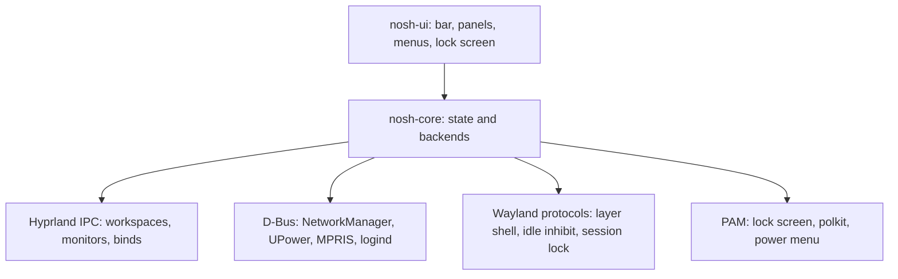

# Architecture

nosh is two crates. `nosh-core` owns system state and has no GTK dependency. `nosh-ui` owns the widgets, the layer-shell surfaces, and the `nosh` binary.



The dependency direction is one way. `nosh-ui` depends on `nosh-core`, and `nosh-core` builds and tests without GTK, a display server, or a compositor.

## State and commands

Each service in `nosh-core` reads one part of the system, keeps a snapshot, and reports changes as events. The UI renders those snapshots and sends user intent back as commands. The channel pair lives in `crates/nosh-core/src/bridge.rs`.

The UI does not query D-Bus or Hyprland directly. That keeps the widgets small and lets the core tests use fake backends.

The services are:

- workspaces and monitors, over Hyprland IPC
- audio, over libpulse
- brightness, over sysfs, brightnessctl, or ddcutil
- battery, over UPower
- network, over NetworkManager
- media, over MPRIS
- tray, over StatusNotifierWatcher
- notifications, as a freedesktop daemon
- menus, over TOML files and builtin or external sources
- auth, over PAM
- power, over logind
- polkit, as an authentication agent
- session lock, over `ext-session-lock-v1`

A missing service does not stop the shell. The service reports unavailable and the matching widget stays hidden or empty. Workspaces, monitor layout, and automatic bind writing need Hyprland. Without it the workspace widget stays empty, monitor commands report a read-only service, and you write the menu binds yourself.

## Idle behavior

The shell avoids timer work while nothing changes. The clock wakes on the next minute boundary, media polling follows the player state, tray menus are built when their popover opens, and the PulseAudio worker blocks until a command arrives.

## Tests

Core tests use fake backends for D-Bus, Hyprland, sysfs, and DDC. Run them with:

```bash
cargo test -p nosh-core
```

The UI is checked by hand. Layer-shell placement, exclusive zones, keyboard grabs, and the visual classes cannot be trusted from unit tests alone.
